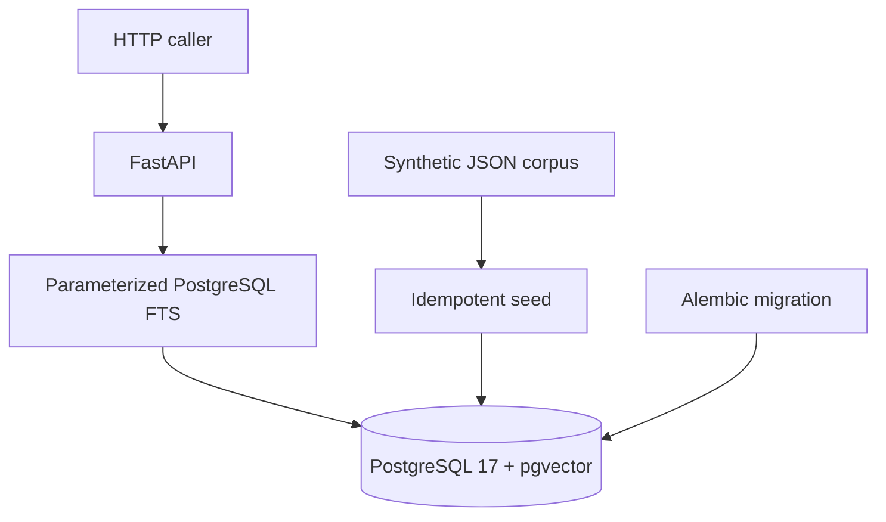

# Architecture — checkpoint 1

AI Quality Lab will separate **retrieval correctness** from **answer quality**. The current implementation deliberately stops after document ingestion and lexical retrieval; generation and semantic evaluation are not implemented yet.

## Implemented path

`documents` stores content and its SHA-256 digest, version, effective date, title and a unique current version per slug. `chunks` stores stable UUIDs, text spans, paragraph chunker version and a generated English `tsvector`. Embeddings are nullable pending the semantic checkpoint, with a constraint requiring model metadata when populated.

Retrieval applies `documents.is_current` before ranking. The API validates input and returns stable fragment IDs; PostgreSQL's `plainto_tsquery` accepts the question as a **bound value**, not SQL string interpolation. No LLM calls or side effects exist in the current read path.

**Known FTS limitation (observed in initial CI):** `plainto_tsquery` applies AND semantics and ranks one chunk at a time. A query with terms spread across several paragraphs can return no results even when the document as a whole contains the answer. We keep this simple baseline explicit rather than silently relaxing relevance; the dataset and later hybrid candidate will measure whether a different retrieval strategy improves these cases.

## Trust and failure boundaries

- Corpus data is synthetic, but still treated as untrusted instructions.
- API does not expose SQL errors or DB credentials in HTTP responses.
- `/health` is independent of `/ready` so a broken DB does not disguise process liveness.
- Seed only inserts; a changed existing document/chunk produces an explicit conflict and transaction rollback.
- Test DB is restricted by name and host; integration fixtures roll back inserted rows.
- Vector similarity and answer citations require their **own** tests before we can claim either works.

## Next checkpoint

Introduce dataset cards and manually reviewed goldens; then implement a version-pinned embedding adapter and compare vector/hybrid retrieval against the unchanged FTS baseline on the same document set. Only after measuring retrieval will we implement RAG generation and LLM-judge calibration.

