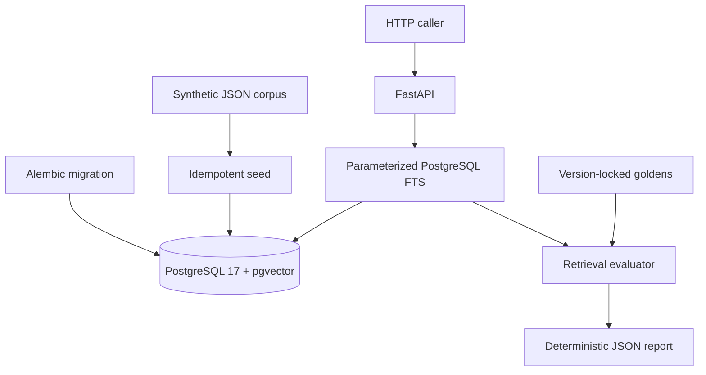

# Architecture — retrieval foundation and experimental evidence gate

AI Quality Lab separates **retrieval correctness** from **answer quality**. The current implementation includes versioned corpus ingestion, lexical + semantic/hybrid retrieval and a deterministic retrieval evaluation harness. Generated answers and answer-level evaluation are not implemented yet.

## Implemented path

`documents` stores content and its SHA-256 digest, version, effective date, title and a unique current version per slug. `chunks` stores stable UUIDs, text spans, paragraph chunker version and a generated English `tsvector`. Optional 384-dimensional embeddings are materialized only for the pinned ONNX experiment, with model metadata paired to the vector.

Retrieval applies `documents.is_current` before ranking. The API validates input and returns stable fragment IDs; PostgreSQL's `plainto_tsquery` accepts the question as a **bound value**, not SQL string interpolation. No LLM calls or side effects exist in the current read path.

**Known FTS limitation (observed in initial CI):** `plainto_tsquery` applies AND semantics and ranks one chunk at a time. A query with terms spread across several paragraphs can return no results even when the document as a whole contains the answer. We keep this simple baseline explicit rather than silently relaxing relevance; the dataset and later hybrid candidate will measure whether a different retrieval strategy improves these cases.

The retrieval evaluator scores current, **version-qualified documents** after deduplicating chunks returned within the exact `top_k` chunk budget. Positive cases get Recall@k, MRR@k and HitRate@k. Negative cases get the fraction of *zero-retrieval* outcomes; this is **not** an LLM abstention test. Every case is retained in a deterministic report alongside separate dev/holdout and tag summaries. Any corpus-byte change or stale expected document version blocks the golden dataset from loading. See the [dataset card](DATASET_CARD.md).

A distinct [evidence-level evaluator](EVIDENCE_PROTOCOL.md) checks labeled **exact quotes and character offsets** against the hash-locked current source corpus and the deterministic chunk UUIDs. Positive questions can require multiple spans from the same document; an individual document match must not hide partial supporting evidence. Citation validation additionally requires a quote to lie within a **retrieved** current chunk and cover a project-labeled anchor. It does **not** infer entailment of unrestricted model prose: actual answer correctness is still unimplemented.

## Trust and failure boundaries

- Corpus data is synthetic, but still treated as untrusted instructions.
- API does not expose SQL errors or DB credentials in HTTP responses.
- `/health` is independent of `/ready` so a broken DB does not disguise process liveness.
- Seed only inserts; a changed existing document/chunk produces an explicit conflict and transaction rollback.
- Test DB is restricted by name and host; integration fixtures roll back inserted rows.
- Exact vector retrieval and **structured source-citation integrity** have separate tests; **generated-answer entailment and citation faithfulness do not**.

## Next checkpoint

The initial 16-case lexical evaluation is pinned for per-case regression checks. The version-pinned ONNX adapter, exact cosine search and chunk-level RRF comparator were measured on PostgreSQL 17 in CI: semantic/hybrid recovered two lexical misses but retrieved neighbors on every unanswerable case. A preliminary top-1 cosine gate was then calibrated only on two `dev` negatives and evaluated on untouched holdout cases (see the [semantic experiment](SEMANTIC_EXPERIMENT.md)). It accepted all 12 labeled positives and rejected all four negatives **on this small synthetic set**, but no answer correctness or calibration guarantee follows. The post-hoc 12-case near-miss challenge retained all six positives but **accepted all six unanswerable questions**. The positives and negatives have overlapping cosine scores, so retuning a single scalar cutoff cannot perfectly separate them. This failed research policy is not enforced in the API. Before any cited generation, the unanswered questions are independently reviewed evidence-span entailment, hard negative review, and actual answer-level abstention.

The [evidence-span CI run](https://github.com/franciscovitar/ai-quality-lab/actions/runs/44574024515) then measured **8/8 labeled source spans retrieved by semantic search** (0/8 by FTS on the paraphrased challenge), while the semantic candidate still returned chunks for **all six unanswerable near misses**. That is why the next subsystem must evaluate whether *the claim follows from the retrieved spans*, rather than merely validating that a similar document or a matching quotation exists. All eight annotations remain project-authored and unreviewed by an independent judge.

