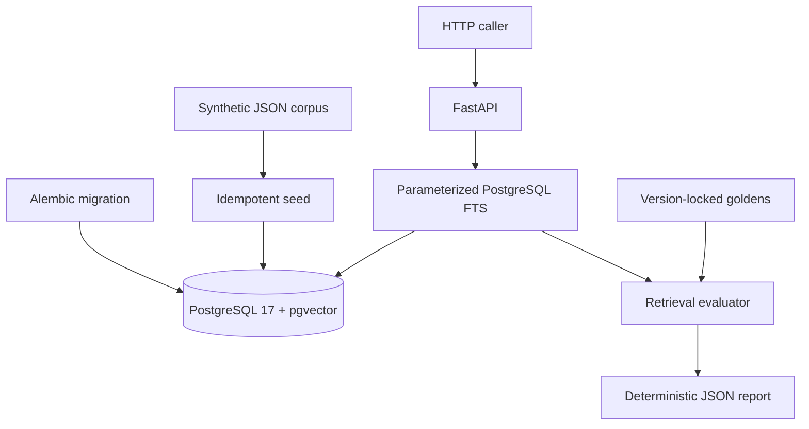

# Architecture — retrieval foundation and layered experimental evidence evaluation

AI Quality Lab separates **retrieval correctness** from **answer quality**. The current implementation includes versioned corpus ingestion, lexical + semantic/hybrid retrieval, a deterministic retrieval evaluator, exact citation checks, a measured NLI classifier, and **pre-annotated response-composition evaluation**. A separate, opt-in CPU experiment now **does generate real small-model answers**, but does **not** connect them to live retrieval, parse unrestricted prose into exhaustive claims or certify factuality.

## Implemented path

`documents` stores content and its SHA-256 digest, version, effective date, title and a unique current version per slug. `chunks` stores stable UUIDs, text spans, paragraph chunker version and a generated English `tsvector`. Optional 384-dimensional embeddings are materialized only for the pinned ONNX experiment, with model metadata paired to the vector.

Retrieval applies `documents.is_current` before ranking. The API validates input and returns stable fragment IDs; PostgreSQL's `plainto_tsquery` accepts the question as a **bound value**, not SQL string interpolation. No LLM calls or side effects exist in the current read path.

**Known FTS limitation (observed in initial CI):** `plainto_tsquery` applies AND semantics and ranks one chunk at a time. A query with terms spread across several paragraphs can return no results even when the document as a whole contains the answer. We keep this simple baseline explicit rather than silently relaxing relevance; the dataset and later hybrid candidate will measure whether a different retrieval strategy improves these cases.

The retrieval evaluator scores current, **version-qualified documents** after deduplicating chunks returned within the exact `top_k` chunk budget. Positive cases get Recall@k, MRR@k and HitRate@k. Negative cases get the fraction of *zero-retrieval* outcomes; this is **not** an LLM abstention test. Every case is retained in a deterministic report alongside separate dev/holdout and tag summaries. Any corpus-byte change or stale expected document version blocks the golden dataset from loading. See the [dataset card](DATASET_CARD.md).

A distinct [evidence-level evaluator](EVIDENCE_PROTOCOL.md) checks labeled **exact quotes and character offsets** against the hash-locked current source corpus and the deterministic chunk UUIDs. Positive questions can require multiple spans from the same document; an individual document match must not hide partial supporting evidence. Citation validation additionally requires a quote to lie within a **retrieved** current chunk and cover a project-labeled anchor. It does **not** infer entailment of unrestricted model prose: actual answer correctness is still unimplemented.

A [separate claim-pair scorer](CLAIM_EVALUATION.md) now accepts verdicts from an external future judge and compares them to 24 version-locked authored `entailed`/`not_entailed` judgments. The first deliberately unsafe baseline declares all authentic citations supportive, exposing false-support errors even though every quote is real. The scorer itself **does not determine** if a claim is entailed; running it against an oracle or citation-only baseline is not a measured LLM capability.

An opt-in pinned ONNX cross-encoder is a **real, separate claim-verdict source**. It consumes exact quote/claim pairs, not complete answers. A [composed-answer evaluator](ANSWER_EVALUATION.md) reuses its verdicts to score 21 **fully pre-annotated** response fixtures for manually required facts, citation-source alignment and abstention. The chain is **corpus → evidence anchors → authored claims → composed answer fixtures → supplied verdicts**. The latter stages are separate from the HTTP API. The actual NLI model incorrectly approved `A021`, a response containing both possible crash orders, illustrating why whole-answer consistency is not guaranteed by isolated sentence entailment checks.

The [real-generation experiment](GENERATION_EXPERIMENT.md) is a **different, isolated path**: version-locked source quotes → prompt builder (with no reference labels) → pinned CPU-only ONNX small-model inference → raw output archive → exact-abstention/citation-*syntax* evaluator. The 12 quotes are curated by hand from the synthetic source corpus; they are **not the output of the retrieval API**. Provenance fingerprints bind prompts, output records, corpus and model-graph SHA-256. The evaluator deliberately does not reuse the claim fixture labels or turn valid citation markers into a factuality verdict. The actual model failed to abstain on all six unsupported prompts in [CI run #44585749946](https://github.com/franciscovitar/ai-quality-lab/actions/runs/44585749946).

For the next experiment, the [frozen-output review](GENERATED_CLAIM_REVIEW.md) retains **byte-identical generated JSON** from a named GitHub runner, then partitions each real answer into human-authored claim and non-claim segments. The verifier rebuilds the original source prompts, checks model/provenance SHA-256 and exact response text coverage, and rejects a claim attributed to a source snippet not shown to the generator. Review labels are explicitly `project_author_provisional` with **zero independent reviewers**, so this path is an integrity-audited annotation scaffold, not a learned classifier or a verified answer-quality gate.

The separate [generated-claim NLI comparison](GENERATED_NLI_EXPERIMENT.md) feeds those frozen claim spans and their exact inspected quotes into the same pinned CPU cross-encoder used on the earlier 24 authored pairs. No labels or rationales go into inference. The diagnostic retains per-claim logits and disagreements with provisional author verdicts; an additional **deliberately unsafe** all-claims-entailed negative control demonstrates that a source-supported assertion can still be an incomplete answer, and that NLI cannot detect fabricated citation markers it was never shown. Neither decision path is exposed via HTTP.

## Trust and failure boundaries

- Corpus data is synthetic, but still treated as untrusted instructions.
- API does not expose SQL errors or DB credentials in HTTP responses.
- `/health` is independent of `/ready` so a broken DB does not disguise process liveness.
- Seed only inserts; a changed existing document/chunk produces an explicit conflict and transaction rollback.
- Test DB is restricted by name and host; integration fixtures roll back inserted rows.
- Exact vector retrieval, **structured source-citation integrity**, isolated-claim NLI and **pre-annotated** response composition have separate tests. A real, small-model generator now has its own tests and CI job, but **actual generated-answer entailment, exhaustive automatic claim extraction and end-to-end attribution still do not**.

## Next checkpoint

The initial 16-case lexical evaluation is pinned for per-case regression checks. The version-pinned ONNX adapter, exact cosine search and chunk-level RRF comparator were measured on PostgreSQL 17 in CI: semantic/hybrid recovered two lexical misses but retrieved neighbors on every unanswerable case. A preliminary top-1 cosine gate was then calibrated only on two `dev` negatives and evaluated on untouched holdout cases (see the [semantic experiment](SEMANTIC_EXPERIMENT.md)). It accepted all 12 labeled positives and rejected all four negatives **on this small synthetic set**, but no answer correctness or calibration guarantee follows. The post-hoc 12-case near-miss challenge retained all six positives but **accepted all six unanswerable questions**. The positives and negatives have overlapping cosine scores, so retuning a single scalar cutoff cannot perfectly separate them. This failed research policy is not enforced in the API. Before deploying any cited generation, the open gates include independent evidence-span entailment review, hard-negative adjudication and validated answer-level abstention.

The [evidence-span CI run](https://github.com/franciscovitar/ai-quality-lab/actions/runs/44574024515) measured **8/8 labeled source spans retrieved by semantic search** (0/8 by FTS on the paraphrased challenge), while the semantic candidate still returned chunks for **all six unanswerable near misses**. The [claim-level NLI run](https://github.com/franciscovitar/ai-quality-lab/actions/runs/44580522095) found **one falsely entailed contradiction among 12 unsupported claims**. The [answer-composition run](https://github.com/franciscovitar/ai-quality-lab/actions/runs/44582652843) showed that this error **propagates to falsely approving a whole contradictory response** despite valid citations and manually required coverage. The [generation run](https://github.com/franciscovitar/ai-quality-lab/actions/runs/44585749946) then found **zero correct strict abstentions in six unsupported questions** from a real small model. Next is an exhaustively reviewed, sealed dataset with independent generated-answer claim annotation, not a production gate. Every current annotation remains project-authored.

