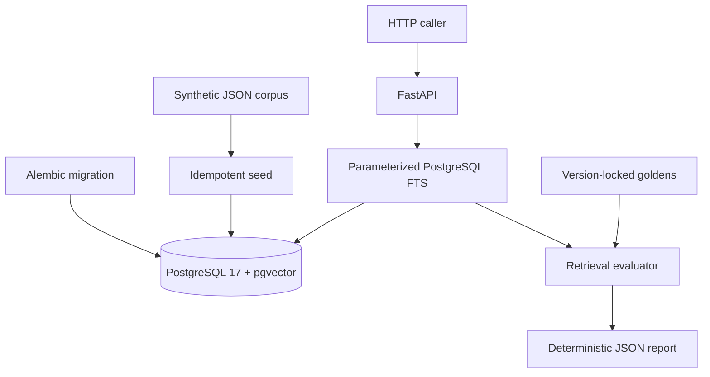

# Architecture — checkpoints 1–2

AI Quality Lab separates **retrieval correctness** from **answer quality**. The current implementation includes versioned corpus ingestion, lexical retrieval and a deterministic retrieval evaluation harness. Generation and semantic evaluation are not implemented yet.

## Implemented path

`documents` stores content and its SHA-256 digest, version, effective date, title and a unique current version per slug. `chunks` stores stable UUIDs, text spans, paragraph chunker version and a generated English `tsvector`. Embeddings are nullable pending the semantic checkpoint, with a constraint requiring model metadata when populated.

Retrieval applies `documents.is_current` before ranking. The API validates input and returns stable fragment IDs; PostgreSQL's `plainto_tsquery` accepts the question as a **bound value**, not SQL string interpolation. No LLM calls or side effects exist in the current read path.

**Known FTS limitation (observed in initial CI):** `plainto_tsquery` applies AND semantics and ranks one chunk at a time. A query with terms spread across several paragraphs can return no results even when the document as a whole contains the answer. We keep this simple baseline explicit rather than silently relaxing relevance; the dataset and later hybrid candidate will measure whether a different retrieval strategy improves these cases.

The evaluator scores current, **version-qualified documents** after deduplicating chunks returned within the exact `top_k` chunk budget. Positive cases get Recall@k, MRR@k and HitRate@k. Negative cases get the fraction of *zero-retrieval* outcomes; this is **not** an LLM abstention test. Every case is retained in a deterministic report alongside separate dev/holdout and tag summaries. Any corpus-byte change or stale expected document version blocks the golden dataset from loading. See the [dataset card](DATASET_CARD.md).

## Trust and failure boundaries

- Corpus data is synthetic, but still treated as untrusted instructions.
- API does not expose SQL errors or DB credentials in HTTP responses.
- `/health` is independent of `/ready` so a broken DB does not disguise process liveness.
- Seed only inserts; a changed existing document/chunk produces an explicit conflict and transaction rollback.
- Test DB is restricted by name and host; integration fixtures roll back inserted rows.
- Vector similarity and answer citations require their **own** tests before we can claim either works.

## Next checkpoint

The initial 16-case lexical evaluation is observed on PostgreSQL 17 and pinned for per-case regression checks (see the dataset card). A separate version-pinned ONNX adapter, exact cosine search and chunk-level RRF comparator are now implemented, with their real-model outcomes to be observed in the new CI job. See the [semantic experiment](SEMANTIC_EXPERIMENT.md). Only after measuring retrieval will we implement cited RAG generation and LLM-judge calibration.

