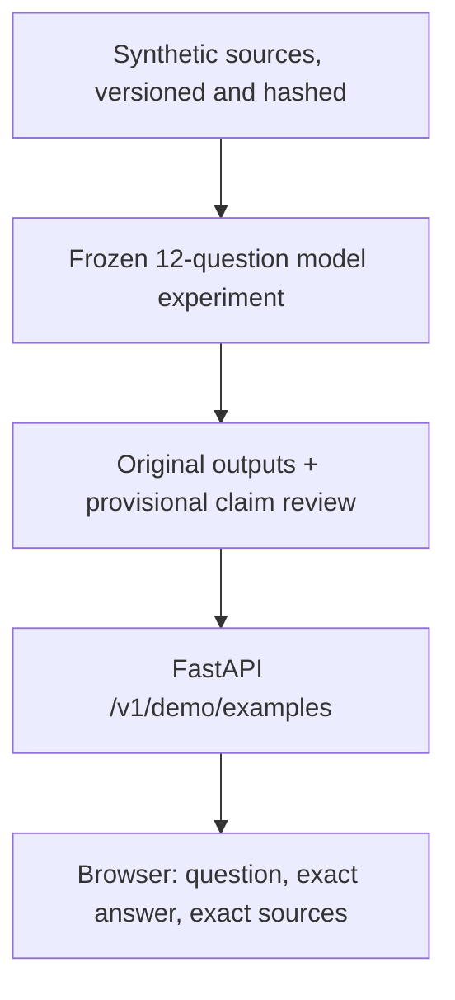

# AI Quality Lab — what does a citation really prove?

**A two-minute case study for Software Engineering / Applied AI interviews.**

## The problem

An application can be available, well-tested and correctly integrated with PostgreSQL yet still present an AI answer that is wrong. A citation may point to a real document without supporting a claim; a relevant source may fail to answer the actual question. **We need to separate software correctness, evidence provenance and answer correctness.**

## What I built

A local Python/FastAPI and PostgreSQL lab over a **versioned synthetic corpus** that tests retrieval, source integrity and reproducible experiments. A pinned 135M-parameter ONNX language model was run separately on 12 questions with hand-selected source passages. Its prompts, original responses and model revision are frozen and source-checked; this demo presents five of those answers. It does not generate new text when you browse.



The rest of the lab separately contains a retrieval baseline (PostgreSQL FTS), pinned CPU semantic retrieval experiments, exact source-span checks, NLI diagnostics, negative controls, tests and GitHub Actions. **A working research job is not a production answer-quality gate.**

## Watch the most revealing failure: R106

1. Start: `docker compose up --build --wait`. Open **[localhost:8001/demo](http://localhost:8001/demo)**.
2. Choose **“Tres días no son treinta”** (R106).
3. Read the exact model response: it claims a **3-day** retention period. The only text supplied to the model states **thirty days**.
4. Notice the evidence label: the contradiction is a **provisional author review**. The implementation validates that its input/output bytes and source links haven't changed; it doesn't magically prove the semantics.

Then compare the other cases:

| Case | What the original model did | What the case teaches |
|---|---|---|
| R101 | Repeated the source's HTTP status codes | An authentic citation is useful but not a blanket quality guarantee |
| R108 | Parroted a true statement about jitter without the requested percentage | Source support and responsiveness are separate dimensions |
| R105 | Cited `[R105:2]` and `[R105:3]` without ever receiving those passages | Citation syntax must be checked against actual context IDs |
| R110 | Produced part of an unsupported SQL deletion command | Source-limited suggestions cannot be trusted as operational instructions |

## Observed evidence, not promises

- [Original CPU generation run](https://github.com/franciscovitar/ai-quality-lab/actions/runs/44588063650) and [frozen output review](GENERATED_CLAIM_REVIEW.md): the 12 original answers are traceable to the checked-in prompts and source snippets.
- This small-model experiment produced **0/6 correct strict abstentions** for unsupported questions and **3/12 valid citation-syntax outcomes**. These numbers reflect this specific synthetic run, **not a general hallucination rate or factuality score**.
- The independent reviewer count is **zero**. Project-author claim labels are explicitly provisional. A real user's question would need a separate end-to-end retrieval, generation and calibrated assessment process.
- [GitHub Actions](https://github.com/franciscovitar/ai-quality-lab/actions) verifies software tests, PostgreSQL integration and the Docker Compose HTTP demo. Every green check must be read alongside the failed model behaviors it reports.

## Engineering decisions and trade-offs

- **Frozen answers vs. live AI:** instant, offline, free and reproducible, but this page is not a chatbot nor a live inference service.
- **Source hashes vs. a plausible narrative:** the demo refuses to serve an altered snapshot. It displays the exact answer/source text rather than rewriting them for readability.
- **Deterministic checks vs. semantic labels:** invented citation IDs and strict refusals are mechanically checkable; whether a passage truly supports a sentence needs careful review. We don't label the provisional review as independent certification.
- **Local-only vs. public deployment:** Compose binds the API to loopback; no credentials, production reliability or public hosting are claimed.

## Reproduce / inspect

```bash
docker compose up --build --wait
# Browser: http://localhost:8001/demo
python scripts/compose_smoke.py
docker compose down
```

Read [README](../README.md) for the optional full Python/PostgreSQL test workflow and [the focus decision](PORTFOLIO_FOCUS.md) for what is intentionally paused. **Next priority is a clear portfolio presentation, not more evaluation machinery.**
